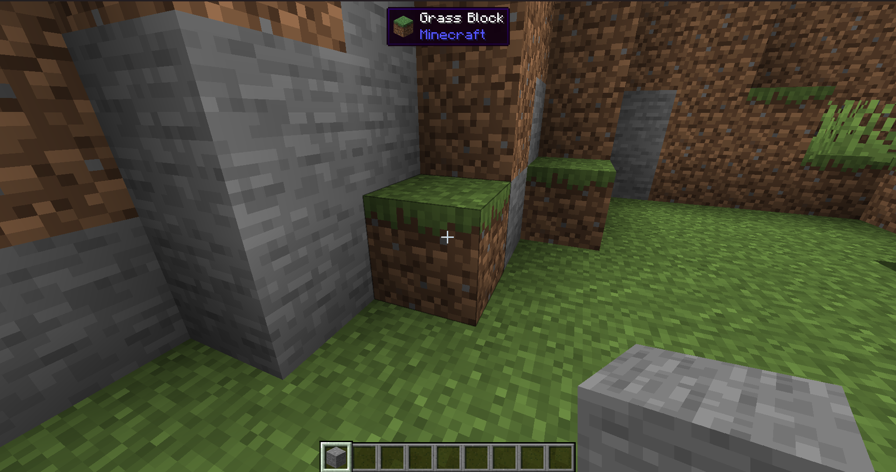

# LookAt

A [Horizon](https://github.com/horizon-rust/horizon) client mod: the block under your crosshair at the top of the
screen, drawn as a vanilla tooltip, with its item's icon, its name in your language and the namespace it comes from.

It sees what you can reach by default, and up to 1024 blocks away (across distant terrain) when you ask it to.



## Settings

Options → Mods → LookAt → settings:

| Option | Values |
| --- | --- |
| Range | Reach (5 blocks), 16, 64, 1024 blocks |
| Position | Top, Top left, Top right |
| Background opacity | 100%, 75%, 50%, 25% |
| Item icon | On, Off |
| Where it comes from | On, Off |
| Position and distance | Off, On: the block's coordinates and its distance from your eyes |

To make the box bigger, raise the game's GUI Scale: mods can't scale text.

## Limits

- **Blocks only.** The mod API (0.1) has no way to see entities, so mobs and players show nothing. Entities will come
  when Horizon adds its planned `target` interface.
- A block without an item of its own (a crop, a wall torch, a potted plant) is named after the item vanilla's pick
  block gives; one with none at all (fire, a portal) gets its id spelled out in English.

## Capabilities

`game-read` (your position and the block you look at), `render` (the box), `recipes` (item names in your language),
`ui` (the settings page) and `storage` (your settings). It sends nothing anywhere: client mods have no network access.

## Build

```sh
rustup target add wasm32-unknown-unknown
cargo install --git https://github.com/horizon-rust/horizon cargo-horizon-mod
cargo horizon-mod build          # target/horizon-mod/lookat.hmod
cargo test                       # unit tests, on the host
cargo horizon-mod test           # tests/*.toml in the game's sandbox
```

The SDK is pinned to a Horizon commit in `Cargo.toml`, so the same source builds the same file.

Written with [Claude Code](https://claude.com/claude-code).

## License

[MIT](LICENSE)
